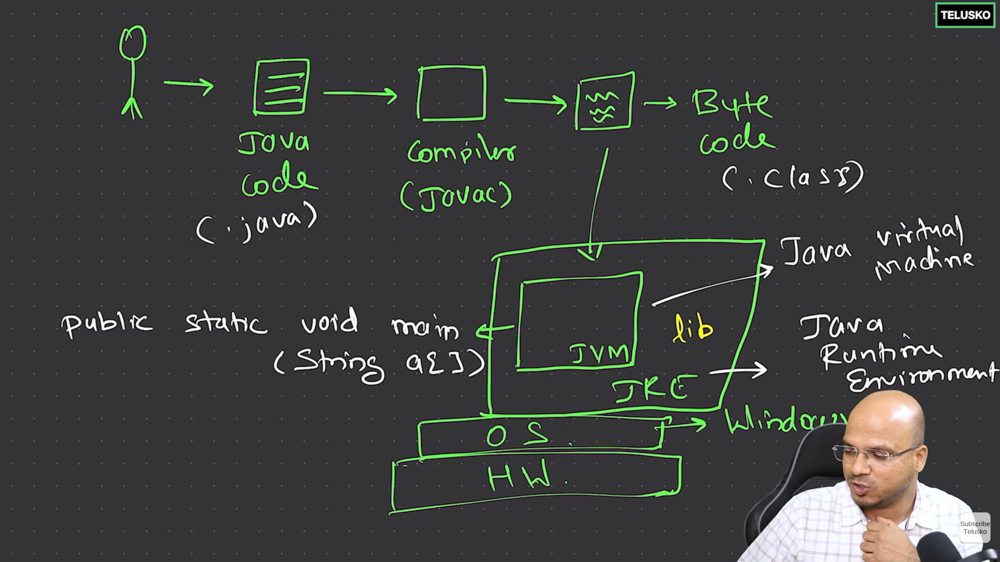
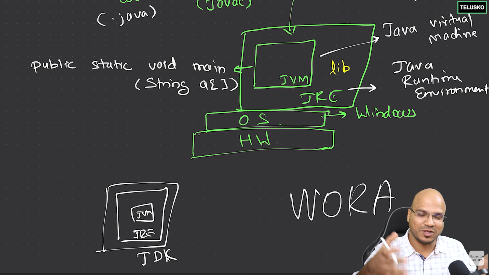

# ☕ How Java Runs Behind the Scenes

When you build and run a Java application, a lot happens behind the screen. This guide explains the whole journey — from your code to the output — in simple terms.

---

<div align="center">
  
</div>


## 🧱 The Stack: Hardware → OS → JVM

Every machine is built in layers:

```
┌─────────────────────────────┐
│           JVM               │  ← Runs your Java bytecode
├─────────────────────────────┤
│      Operating System       │  ← Windows / Linux / macOS
├─────────────────────────────┤
│          Hardware           │  ← Laptop, desktop, phone
└─────────────────────────────┘
```

- The **OS** runs on top of the **hardware**.
- The **JVM (Java Virtual Machine)** runs on top of the **OS**.
- The JVM's job is to **execute Java code**.

> 💡 **Key point:** If you have a JVM, you can run Java applications. If you don't have a JVM, you can't.

---

## 🌍 Is Java Really Platform Independent?

This is a common confusion. Let's clear it up.

### ✅ Your Java application is platform independent

You can run the **same application** on any machine — Windows, Linux, or macOS — as long as that machine has a **JVM** installed.

### ⚠️ But the JVM itself is platform dependent

The JVM must be **built specifically for each OS**. For example, a standard JVM isn't readily available on iOS the same way it is on desktop platforms.

So the truth is:

| Thing | Platform Independent? |
| :--- | :--- |
| Your Java application (bytecode) | ✅ Yes |
| The JVM that runs it | ❌ No — it depends on the OS |

> **In short:** Your application is independent, but the JVM is dependent on the platform.

---

## 🔄 From Java Code to Execution

Programmers write **readable Java code**. But the JVM does **not** understand Java code directly. It only understands **bytecode** — an unreadable format for humans.

So we need a translator in between. That translator is the **compiler (`javac`)**.

### The flow

```
Java Code (.java)  ──►  Compiler (javac)  ──►  Bytecode (.class)  ──►  JVM  ──►  Output
```

1. **You write** the Java code (`.java` file).
2. **The compiler** (`javac`) converts it into **bytecode** (`.class` file).
3. **The JVM** reads the bytecode and executes it.
4. **You get** the output.

> 💡 You can't write bytecode yourself — it's not human-readable. That's why we write Java and let `javac` do the conversion.

---

## 🚪 The Entry Point: `main()` Method

A real project can have **10, 100, or even 1000 files**. The JVM needs to know **which file to start with**.

### Rules for the starting file

- You must **tell the JVM which file to run first**.
- That starting file **must contain a `main` method**.
- The `main` method must have a **specific signature** — not just any `main`.

### The required signature

```java
public static void main(String a[])
```

The JVM looks for this exact signature. Without it, your code **will not run**.

> A "signature" means the method name, its parameters, and its modifiers — the whole declaration together.

The execution starts from the file you specify, and from there it calls other files as needed.

---

## 👨‍💻 Your First Java Program

Java is **object-oriented (OOPS)**. That means everything should be an **object**, and to create an object you need a **class**.

Here is a simple program — `Hello.java`:

```java
class Hello {

    public static void main(String a[])
    {
        System.out.println("Hello world");
    }

}
```

### Step 1 — Compile the file

```shell
javac Hello.java
```

This produces a `Hello.class` file (bytecode).

### Step 2 — Run the program

```shell
java Hello
```

> **Note:** Use the **class name** (`Hello`), **not** the file name (`Hello.java`), when running.

---

## 📚 JVM vs JRE vs JDK

<div align="center">
  
</div>

To run a Java application, you need more than just the JVM. You also need **libraries** and a **runtime environment**.

That's where **JRE** comes in.

### What each one means

| Component | Full Form | What it contains |
| :--- | :--- | :--- |
| **JVM** | Java Virtual Machine | Executes the bytecode |
| **JRE** | Java Runtime Environment | JVM + core libraries + runtime files |
| **JDK** | Java Development Kit | JRE + development tools (like `javac`) |

### The nesting

```
┌───────────────────────────────┐
│             JDK               │
│  ┌─────────────────────────┐  │
│  │           JRE           │  │
│  │  ┌───────────────────┐  │  │
│  │  │       JVM         │  │  │
│  │  └───────────────────┘  │  │
│  │   + Libraries           │  │
│  └─────────────────────────┘  │
│   + Development Tools         │
│     (javac, jar, etc.)        │
└───────────────────────────────┘
```

- **JVM is part of JRE.**
- **JRE is part of JDK.**
- The **libraries live in the JRE**, not inside the JVM.

> ⚠️ Common mistake: Saying "libraries are inside the JVM." They are **not** — they are part of the JRE.

---

## 🧑‍💻 What a Developer Needs vs. What a User Needs

This is important when you distribute your application.

### On the developer's machine

- Install **JDK** (which brings JRE + JVM + `javac`).
- You need `javac` to **compile** code.

### On the user's machine

- Only needs **JRE** (which includes JVM + libraries).
- **JDK is NOT required** to run a Java application.

> 🎯 Example: You build a media app and share it with a friend. Your friend only needs **JRE + JVM** — not the full JDK.

---

## 🔄 Java Versions, LTS & the Developer's JDK

As a developer, the **JDK is essential** — it is your main toolkit. Here is why, and how versions work.

### Installing a new JDK

- When you install a **new JDK**, you automatically get the **updated JRE and JVM** that come with it.
- So you don't install the JRE and JVM separately — the JDK bundles them together.

### LTS versions (Long-Term Support)

- Most people use an **LTS version** of Java.
- LTS versions are **stable, well-supported, and receive updates for a long time**.
- They are the safe choice for real projects and production use.

### How new versions work

- Every new Java version brings **minor features and updates**.
- But the **base remains the same**.
- And the **core concepts never change** — the fundamentals you learn stay valid across all versions.

> 💡 **In short:** Install the JDK (preferably an LTS version), and you get JRE + JVM + tools together. New versions add small features, but the core of Java stays the same.

---


## ✨ WORA — Write Once, Run Anywhere

This is the big promise of Java.

- You write and compile your code **once** on your machine.
- You can run it on **any other machine**.
- The only requirement: that machine has **JRE and JVM** installed.

That's why Java is called **WORA** — **W**rite **O**nce, **R**un **A**nywhere.

---

